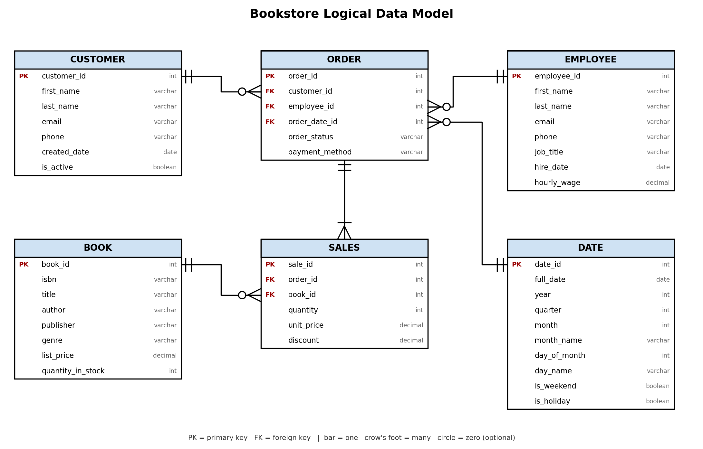
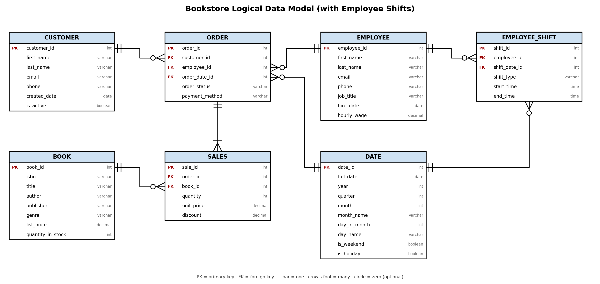

# DC Assignment 2: Design a Logical Model and Advanced SQL

🚨 **Please review our [Assignment Submission Guide](https://github.com/UofT-DSI/onboarding/blob/main/onboarding_documents/submissions.md)** 🚨 for detailed instructions on how to format, branch, and submit your work. Following these guidelines is crucial for your submissions to be evaluated correctly.

#### Submission Parameters:
* Submission Due Date: `April 07, 2026`
* Weight: 70% of total grade
* The branch name for your repo should be: `assignment-two`
* What to submit for this assignment:
    * This markdown (Assignment2.md) with written responses in Section 1 and 4
    * Two Entity-Relationship Diagrams (preferably in a pdf, jpeg, png format).
    * One .sql file 
* What the pull request link should look like for this assignment: `https://github.com/<your_github_username>/sql/pulls/<pr_id>`
    * Open a private window in your browser. Copy and paste the link to your pull request into the address bar. Make sure you can see your pull request properly. This helps the technical facilitator and learning support staff review your submission easily.

Checklist:
- [ ] 🚨🚨🚨 After forking, open the **Actions** tab in your own SQL repository. If prompted, click **I understand my workflows, go ahead and enable them** before opening your assignment pull request. This enables automatic SQL feedback on your pull request.
- [ ] Create a branch called `assignment-two`.
- [ ] Ensure that the repository is public.
- [ ] Review [the PR description guidelines](https://github.com/UofT-DSI/onboarding/blob/main/onboarding_documents/submissions.md#guidelines-for-pull-request-descriptions) and adhere to them.
- [ ] Verify that the link is accessible in a private browser window.

If you encounter any difficulties or have questions, please don't hesitate to reach out to our team via our Slack. Our Technical Facilitators and Learning Support staff are here to help you navigate any challenges.

***

## Section 1:
You can start this section following *session 1*, but you may want to wait until you feel comfortable wtih basic SQL query writing. 

Steps to complete this part of the assignment:
- Design a logical data model
- Duplicate the logical data model and add another table to it following the instructions
- Write, within this markdown file, an answer to Prompt 3


###  Design a Logical Model

#### Prompt 1
Design a logical model for a small bookstore. 📚

At the minimum it should have employee, order, sales, customer, and book entities (tables). Determine sensible column and table design based on what you know about these concepts. Keep it simple, but work out sensible relationships to keep tables reasonably sized. 

Additionally, include a date table. 
A date table (also called a calendar table) is a permanent table containing a list of dates and various components of those dates. Some theory, tips, and commentary can be found [here](https://www.sqlshack.com/designing-a-calendar-table/), [here](https://www.mssqltips.com/sqlservertip/4054/creating-a-date-dimension-or-calendar-table-in-sql-server/) and [here](https://sqlgeekspro.com/creating-calendar-table-sql-server/). 
Remember, you don't actually need to run any of the queries in these articles, but instead understand *why* date tables in SQL make sense, and how to situate them within your logical models.

There are several tools online you can use, I'd recommend [Draw.io](https://www.drawio.com/) or [LucidChart](https://www.lucidchart.com/pages/).

**HINT:** You do not need to create any data for this prompt. This is a conceptual model only. 

#### Prompt 2
We want to create employee shifts, splitting up the day into morning and evening. Add this to the ERD.

#### Prompt 3
The store wants to keep customer addresses. Propose two architectures for the CUSTOMER_ADDRESS table, one that will retain changes, and another that will overwrite. Which is type 1, which is type 2? 

**HINT:** search type 1 vs type 2 slowly changing dimensions. 

#### ERD 1: Bookstore logical model (Prompt 1)



The model contains the `customer`, `order`, `sales`, `employee` and `book` tables plus a `date` (calendar) table. A customer places many orders, and an employee processes many orders. An order has one or more `sales` lines, and each line is for one book. Orders are linked to the `date` table through `order_date_id`, so reporting by year, quarter, month, weekday or holiday does not need date calculations on every query.

#### ERD 2: Bookstore logical model with employee shifts (Prompt 2)



`employee_shift` was added to split the working day into a morning and an evening shift. Each row assigns one employee to one shift on one date: `shift_type` holds `'morning'` or `'evening'`, with `start_time` and `end_time` (for example 08:00-14:00 and 14:00-20:00). It links to `employee` through `employee_id` and to `date` through `shift_date_id`. An employee can have many shifts, and a date can have many shifts.

#### Prompt 3: CUSTOMER_ADDRESS architectures

```
Type 1 slowly changing dimension (overwrite) -- no history is kept.

CUSTOMER_ADDRESS
  customer_id (PK, FK -> customer.customer_id)
  street_address
  city
  province_state
  postal_code
  country

Each customer has exactly one address row. When a customer moves, the existing row is updated
(overwritten) with the new address, so the old address is lost.


Type 2 slowly changing dimension (retain changes) -- full history is kept.

CUSTOMER_ADDRESS
  customer_address_id (PK, surrogate key)
  customer_id (FK -> customer.customer_id)
  street_address
  city
  province_state
  postal_code
  country
  effective_start_date
  effective_end_date   (NULL or 9999-12-31 while the address is current)
  is_current           (boolean)

When a customer moves, the current row is closed by setting effective_end_date and is_current = false,
and a new row is inserted with the new address and is_current = true. A customer can have many
address rows over time, so past orders can still be tied to the address the customer had at that time.
```

The first design (overwrite) is **Type 1** and the second design (retain changes with start/end dates and a current flag) is **Type 2**.

***

## Section 2:
You can start this section following *session 4*.

Steps to complete this part of the assignment:
- Open the assignment2.sql file in DB Browser for SQLite:
	- from [Github](./02_activities/assignments/assignment2.sql)
	- or, from your local forked repository  
- Complete each question, by writing responses between the QUERY # and END QUERY blocks


### Write SQL

#### COALESCE
1. Our favourite manager wants a detailed long list of products, but is afraid of tables! We tell them, no problem! We can produce a list with all of the appropriate details. 

Using the following syntax you create our super cool and not at all needy manager a list:
```
SELECT 
product_name || ', ' || product_size|| ' (' || product_qty_type || ')'
FROM product
```

But wait! The product table has some bad data (a few NULL values). 
Find the NULLs and then using COALESCE, replace the NULL with a blank for the first column with nulls, and 'unit' for the second column with nulls. 

**HINT**: keep the syntax the same, but edited the correct components with the string. The `||` values concatenate the columns into strings. Edit the appropriate columns -- you're making two edits -- and the NULL rows will be fixed. All the other rows will remain the same.

<div align="center">-</div>

#### Windowed Functions
1. Write a query that selects from the customer_purchases table and numbers each customer’s visits to the farmer’s market (labeling each market date with a different number). Each customer’s first visit is labeled 1, second visit is labeled 2, etc. 

You can either display all rows in the customer_purchases table, with the counter changing on each new market date for each customer, or select only the unique market dates per customer (without purchase details) and number those visits. 

**HINT**: One of these approaches uses ROW_NUMBER() and one uses DENSE_RANK().

Filter the visits to dates before April 29, 2022.

2. Reverse the numbering of the query so each customer’s most recent visit is labeled 1, then write another query that uses this one as a subquery (or temp table) and filters the results to only the customer’s most recent visit. 
**HINT**: Do not use the previous visit dates filter.

3. Using a COUNT() window function, include a value along with each row of the customer_purchases table that indicates how many different times that customer has purchased that product_id.

You can make this a running count by including an ORDER BY within the PARTITION BY if desired.
Filter the visits to dates before April 29, 2022.

<div align="center">-</div>

#### String manipulations
1. Some product names in the product table have descriptions like "Jar" or "Organic". These are separated from the product name with a hyphen. Create a column using SUBSTR (and a couple of other commands) that captures these, but is otherwise NULL. Remove any trailing or leading whitespaces. Don't just use a case statement for each product! 

| product_name               | description |
|----------------------------|-------------|
| Habanero Peppers - Organic | Organic     |

**HINT**: you might need to use INSTR(product_name,'-') to find the hyphens. INSTR will help split the column. 

2. Filter the query to show any product_size value that contain a number with REGEXP. 

<div align="center">-</div>

#### UNION
1. Using a UNION, write a query that displays the market dates with the highest and lowest total sales.

**HINT**: There are a possibly a few ways to do this query, but if you're struggling, try the following: 1) Create a CTE/Temp Table to find sales values grouped dates; 2) Create another CTE/Temp table with a rank windowed function on the previous query to create "best day" and "worst day"; 3) Query the second temp table twice, once for the best day, once for the worst day, with a UNION binding them. 

***

## Section 3:
You can start this section following *session 5*.

Steps to complete this part of the assignment:
- Open the assignment2.sql file in DB Browser for SQLite:
	- from [Github](./02_activities/assignments/assignment2.sql)
	- or, from your local forked repository  
- Complete each question, by writing responses between the QUERY # and END QUERY blocks

### Write SQL

#### Cross Join
1. Suppose every vendor in the `vendor_inventory` table had 5 of each of their products to sell to **every** customer on record. How much money would each vendor make per product? Show this by vendor_name and product name, rather than using the IDs.

**HINT**: Be sure you select only relevant columns and rows. Remember, CROSS JOIN will explode your table rows, so CROSS JOIN should likely be a subquery. Think a bit about the row counts: how many distinct vendors, product names are there (x)? How many customers are there (y). Before your final group by you should have the product of those two queries (x\*y). 

<div align="center">-</div>

#### INSERT
1. Create a new table "product_units". This table will contain only products where the `product_qty_type = 'unit'`. It should use all of the columns from the product table, as well as a new column for the `CURRENT_TIMESTAMP`.  Name the timestamp column `snapshot_timestamp`.

2. Using `INSERT`, add a new row to the product_unit table (with an updated timestamp). This can be any product you desire (e.g. add another record for Apple Pie). 

<div align="center">-</div>

#### DELETE 
1. Delete the older record for whatever product you added.

**HINT**: If you don't specify a WHERE clause, [you are going to have a bad time](https://imgflip.com/i/8iq872).

<div align="center">-</div>

#### UPDATE
1. We want to add the current_quantity to the product_units table. First, add a new column, `current_quantity` to the table using the following syntax.
```
ALTER TABLE product_units
ADD current_quantity INT;
```

Then, using `UPDATE`, change the current_quantity equal to the **last** `quantity` value from the vendor_inventory details. 

**HINT**: This one is pretty hard. First, determine how to get the "last" quantity per product. Second, coalesce null values to 0 (if you don't have null values, figure out how to rearrange your query so you do.) Third, `SET current_quantity = (...your select statement...)`, remembering that WHERE can only accommodate one column. Finally, make sure you have a WHERE statement to update the right row, you'll need to use `product_units.product_id` to refer to the correct row within the product_units table. When you have all of these components, you can run the update statement.
*** 

## Section 4:
You can start this section anytime.

Steps to complete this part of the assignment:
- Read the article
- Write, within this markdown file, between 250 and 1000 words. No additional citations/sources are required.


### Ethics

Read: Boykis, V. (2019, October 16). _Neural nets are just people all the way down._ Normcore Tech. <br>
    https://vicki.substack.com/p/neural-nets-are-just-people-all-the

**What are some of the ethical issues important to this story?**

Consider, for example, concepts of labour, bias, LLM proliferation, moderating content, intersection of technology and society, ect. 


```
The article ‘Neural nets are just people all the way down’ by Vicki Boykis demonstrates that machine learning is guided by humans—not just machines.
In modern day society, we are adapting to using machine learning. Vicki provides an example of a clothing store to show that robots cannot manipulate fabrics for clothing production as well as humans can, especially with fast fashion. We must program the computers to identify objects the way that humans do using neural nets. Datasets are created manually by hundreds of thousands of people to create deep neural networks. This outlines a prime technology and society relationship, whereby we—as a society—shape technology. Decision-making in high-tech neural networks relies on manual human labor.

So, what are some more ethical implications to this? To answer that, based on the article, one extreme view is that algorithms have the potential to ‘spread lies’ and ‘break democracy’. Large language model (LLM) proliferation refers to the massive and rapid spread of publicly available text deployed across global industries and consumer applications. LLM is a machine learning model (i.e., a neural network) trained on a large amount of text for natural language processing tasks. Since these models learn from huge amounts of text, they have the potential to spread public (and leak private) information rapidly. Notably, from an ethical standpoint, these models can amplify certain patterns in prejudices, strain data integrity, exploit workers, and have longstanding copyright infringement issues. Global workers in lower-income countries may be exploited in content moderation. Data labellers can be poorly paid and unseen. They may not receive adequate payment for their services. This is an ethical consideration for global sharing with technology. Humans are still needed where automation is expected.

Fortunately, these modern technologies continue to have a transformative potential to improve society through spreading and developing important information that benefits society. Overall, it is important that we take responsibility, as humans, to moderate content and continually train in the field of artificial intelligence while ensuring ethical issues are reduced. Artificial intelligence as a modern field hires specialized scientists to overcome labour gaps. These scientists must be continually training with ethical principles in mind to ensure a safe bridging between technology and society. Neural networks and deep machine learning shape our past, present, and future.

```
